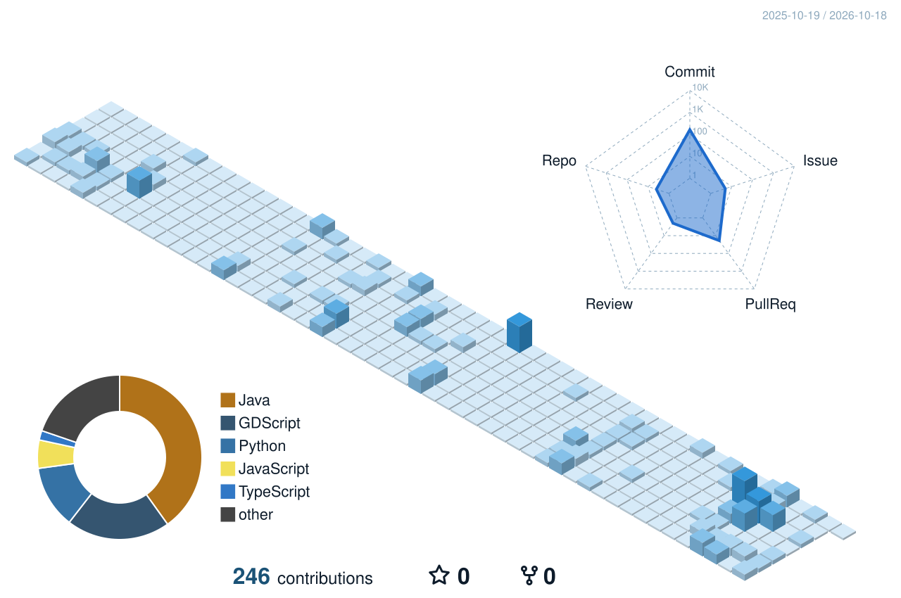

<!--
  PERFIL PERSONALIZADO PARA BernardoCipolli
  Inspirado no tema Gojo de gianna236/gianna236.
  Os gráficos SVG e a cobrinha são automáticos após executar as GitHub Actions.
-->

  <!-- Banner Gojo escolhido por Bernardo. Arquivo local dentro de assets/. -->
  

  <h1>BERNARDO CIPOLLI</h1>
  
<b>Desenvolvimento • Tecnologia • Criatividade</b>

  
Explorando novas tecnologias, criando projetos e evoluindo uma linha de código por vez.

  <!-- Frases animadas: agora com seu nome -->
  

    
    
    
    
    
  

  

---

  <h2>✦ Sobre mim ✦</h2>
  
Olá! Eu sou <b>Bernardo Cipolli</b>. Gosto de tecnologia, programação e de transformar ideias em projetos.

  <a href="https://github.com/BernardoCipolli?tab=repositories">Ver meus repositórios</a>

---

  <h2>⚔️ Tecnologias</h2>
  <!-- Personalize estes ícones de acordo com suas habilidades reais. -->
  

---

  <h2>📊 Estatísticas reais — BernardoCipolli</h2>
  <!-- Os cartões consultam automaticamente as informações públicas da sua conta. -->
  

   

  
  

   

  
  

---

  <h2>🗓️ Meu gráfico 3D de contribuições</h2>
  <!-- O SVG abaixo é criado somente quando a Action "Gojo - Gerar gráfico 3D" executar com sucesso. -->
  

---

  <h2>🐍 Minha cobrinha de contribuições</h2>
  <!-- A branch output e este SVG serão criados pela Action "Gojo - Gerar cobrinha". -->
  <picture>
    <source media="(prefers-color-scheme: dark)" srcset="https://raw.githubusercontent.com/BernardoCipolli/BernardoCipolli/output/github-contribution-grid-snake-dark.svg" />
    <source media="(prefers-color-scheme: light)" srcset="https://raw.githubusercontent.com/BernardoCipolli/BernardoCipolli/output/github-contribution-grid-snake.svg" />
    
  </picture>

---

  
    
  
  Perfil personalizado para <a href="https://github.com/BernardoCipolli">Bernardo Cipolli</a> · layout inspirado no <a href="https://github.com/gianna236/gianna236">perfil temático do Gojo de gianna236</a>.

