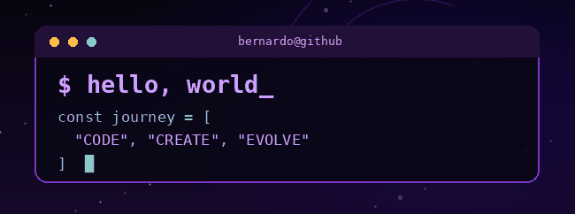

<!-- Perfil: github.com/BernardoCipolli | Tema dark roxo e preto -->

<div align="center">

  

  <a href="https://github.com/BernardoCipolli">
    
  </a>

  <br /><br />

  

</div>

---

### 🟣 Sobre mim

```javascript
const bernardo = {
  perfil: "Entusiasta de tecnologia e programação",
  foco: "Aprender, criar e evoluir",
  interesses: ["Desenvolvimento", "Tecnologia", "Novos projetos"],
  lema: "Sempre existe algo novo para construir."
};
```

<div align="center">

  <!-- GIF PERSONALIZÁVEL: troque assets/animacao.gif pelo GIF de sua preferência. -->
  

</div>

---

### ⚡ Tecnologias para explorar

<!-- Edite os ícones abaixo para refletir as linguagens que você usa de verdade. -->
<div align="center">
  
</div>

---

### 📊 GitHub em números

<div align="center">
  
  
</div>

<!-- Os cartões acima dependem de um serviço externo e podem ficar temporariamente indisponíveis. -->

---

### 📈 Gráfico de atividades

<div align="center">
  
</div>

---

### 🐍 Minha cobrinha de contribuições

<div align="center">
  <!-- A imagem abaixo surge após executar a Action do arquivo .github/workflows/snake.yml. -->
  
</div>

---

<div align="center">
  <a href="https://github.com/BernardoCipolli?tab=repositories">
    
  </a>

  <br /><br />

  <sub>Feito com 💜 e muita curiosidade.</sub>

  
</div>
